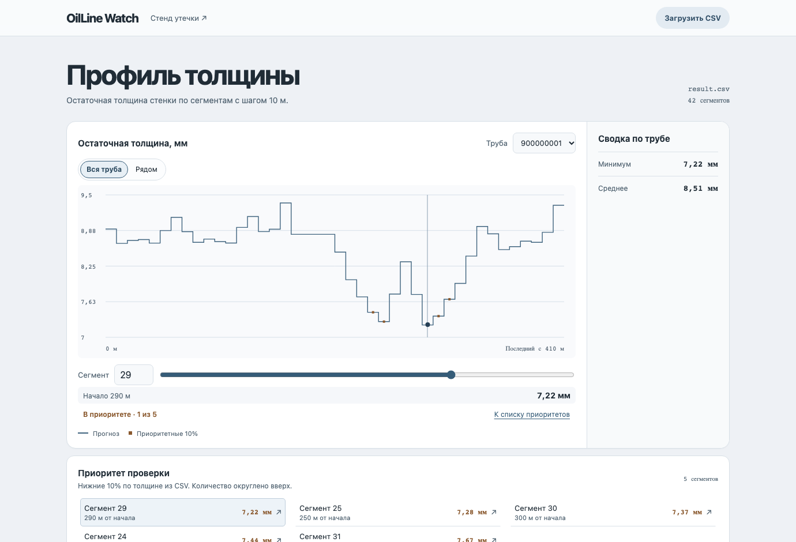

# OilLine Watch

**Turn inspection history into a map of where to inspect next.**

Pipeline integrity teams need to decide where to verify wall loss between costly inspections. OilLine Watch estimates the minimum remaining wall thickness in each 10 m segment and ranks the thinnest segments for follow-up. Engineers can inspect the profile in a browser and export the shortlist for planning.

> **Stage** · Engineering prototype for evaluation on synthetic data. Field accuracy and thresholds for operational decisions have yet to be established.



## Two workflows

| Workflow | What the user can do |
| --- | --- |
| **Inspection planning** | Generate a wall-thickness profile from local CSVs. Select a segment, inspect nearby estimates, and review the lowest 10% by predicted thickness. |
| **Pressure-response lab** | Pick a point on a 3D synthetic pipe, introduce a simulated leak, and compare three virtual pressure sensors with a nominal run. Reveal the chosen point and export a replay. |

The two workflows run independently. The pressure lab illustrates transient response. The segment forecast estimates wall loss over an inspection horizon. [See the evaluation method](docs/methodology.md).

## Try the browser demo

Use the Node version in [`.nvmrc`](.nvmrc). Install dependencies once and start the local UI.

```sh
npm ci
npm run dev
```

Open the local URL printed by Vite. On the home page, select a point on the pipe by clicking, tapping, or using the slider. Choose **Начать показ** to run the lab at 4×. Once the warm-up finishes, open the leak controls and apply the event. The graph shows the signed pressure residuals from the simulation. The result screen reveals the chosen coordinate. A 2D view is available when WebGL is unavailable.

Open `/degradation.html` to view thickness profiles. Choose **Загрузить CSV** and open the forecast generated below. The browser reads the file locally.

<details>
<summary>Preview the 3D pressure lab</summary>


</details>

## Run a thickness forecast

Use Python 3.12 or newer. The [synthetic workflow](examples/synthetic/) builds example inputs and forecasts two fictional pipe sections for 1 January 2025.

```sh
python3 -m venv .venv
. .venv/bin/activate
python -m pip install -r submission/requirements.txt
python -m examples.synthetic.generate .demo
```

Open `.demo/forecast/result.csv` in the profile viewer. For your own CSVs, run `python -m submission.run --help` and supply the data directory, output directory, section IDs, and forecast dates.

The CLI writes one row per 10 m segment to `result.csv` using `id`, `segment_id`, and `thickness_pred` in millimetres. It also writes `priority.csv`, a historical metrics report, and a run manifest.

## How it works

| Component | Role |
| --- | --- |
| `submission/` | Python data normalization, segment grid, forecast and historical scoring. Repeated inspection starts from prior wall-thickness observations. A first-inspection estimate starts from nominal thickness and uses terrain and recorded operating exposure. |
| `src/degradation/` | Browser profile viewer, per-section segment selection and inspection priority list. |
| `src/physics/`, `src/runtime/`, `src/ui/` | Synthetic pipe hydraulics, browser workers, Three.js / WebGL with a 2D fallback, pressure plots and local replay. |

Historical checks use inputs dated before the inspection being predicted and report absolute error in millimetres alongside Pearson correlation. Review the signed correlation when assessing inspection order, since squaring it removes direction. A displayed scenario spread shows sensitivity to coordinate alignment. It carries no calibrated probability.

## Verification

```sh
npm run verify
npx playwright install chromium
npm run test:e2e
python -m pip install pytest
python -m pytest submission/tests
```

Use the workbench to compare methods and organize inspection review. Validate the model on representative held-out inspections before using forecasts in maintenance decisions. The synthetic lab provides an inspectable scenario and known event location for demonstration.

Keep inspection and telemetry files outside the repository. Use synthetic fixtures in examples and tests.
