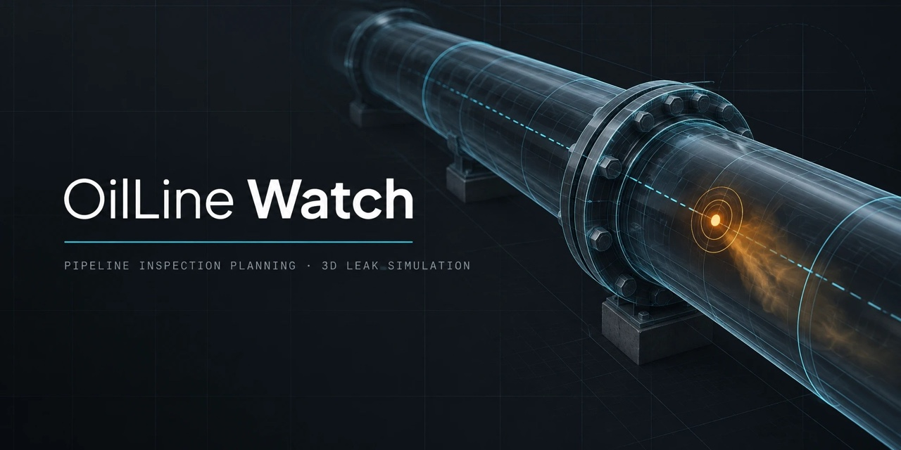
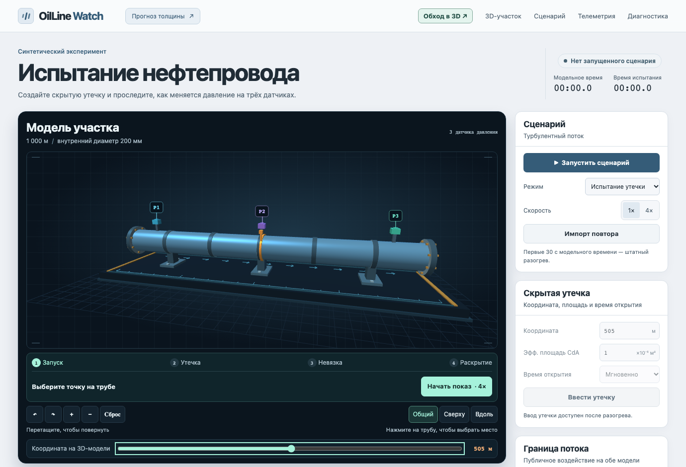

# OilLine Watch

[](https://rtexty.github.io/oilline-watch/?forecast=demo)

**Wall-thickness forecasting and a 3D pressure lab for oil pipelines.**

[](https://rtexty.github.io/oilline-watch/?forecast=demo)
[](https://rtexty.github.io/oilline-watch/degradation.html?forecast=demo)

[](https://github.com/rTexty/oilline-watch/actions/workflows/pages.yml)


[](examples/synthetic/)

Pipeline integrity teams need to decide where to verify wall loss between inspections. OilLine Watch estimates the minimum remaining wall thickness in each 10 m segment and ranks the thinnest segments for follow-up.

[](https://rtexty.github.io/oilline-watch/?forecast=demo)

## Try it in your browser

**3D pressure lab.** Pick a point on the pipe and select **Начать показ** to start the simulation at 4×. After warm-up, apply the leak and compare the virtual sensor readings with the nominal pressure trajectory. Finish and reveal the event to see the selected coordinate. On devices without WebGL, the lab uses a 2D view.

**Inspection planning.** Open the profile with two fictional routes. Select a segment on the chart or choose a row from the 10% with the lowest predicted thickness. Use **Загрузить CSV** to open another forecast. The browser reads the file locally.

<details>
<summary>Preview the thickness profile</summary>

[](https://rtexty.github.io/oilline-watch/degradation.html?forecast=demo)

</details>

Both demos use synthetic data and require no installation. The pressure lab illustrates transient response. The segment forecast estimates wall loss over an inspection horizon. Field accuracy and thresholds for operational decisions have yet to be established. [See the evaluation method](docs/methodology.md).

## Run locally

Use the Node version in [`.nvmrc`](.nvmrc) to start the browser UI.

```sh
npm ci
npm run dev
```

Open the local URL printed by Vite for the pressure lab. Open `/degradation.html` and use **Загрузить CSV** to view the forecast generated below.

## Run a thickness forecast

Use Python 3.12 or newer. The [synthetic workflow](examples/synthetic/) builds example inputs and forecasts two fictional pipe sections for 1 January 2025.

```sh
python3 -m venv .venv
. .venv/bin/activate
python -m pip install -r submission/requirements.txt
python -m examples.synthetic.generate .demo
```

Open `.demo/forecast/result.csv` in the profile viewer. For your own CSVs, run `python -m submission.run --help` and supply the data directory, output directory, section IDs, and forecast dates.

The CLI writes one row per 10 m segment to `result.csv` using `id`, `segment_id`, and `thickness_pred` in millimetres. It also writes `priority.csv`, a historical metrics report, and a run manifest.

## How it works

| Component | Role |
| --- | --- |
| `submission/` | Python data normalization, segment grid, forecast and historical scoring. Repeated inspection starts from prior wall-thickness observations. A first-inspection estimate starts from nominal thickness and uses terrain and recorded operating exposure. |
| `src/degradation/` | Browser profile viewer, per-section segment selection and inspection priority list. |
| `src/physics/`, `src/runtime/`, `src/ui/` | Synthetic pipe hydraulics, browser workers, Three.js / WebGL with a 2D fallback, pressure plots and local replay. |

Historical checks use inputs dated before the inspection being predicted and report absolute error in millimetres alongside Pearson correlation. Review the signed correlation when assessing inspection order, since squaring it removes direction. A displayed scenario spread shows sensitivity to coordinate alignment. It carries no calibrated probability.

## Verification

GitHub Actions runs the frontend checks, a Chromium smoke suite, and the Python forecast checks on pull requests to `main` and on pushes to `main`. Pages deploys after both checks pass on `main`. The Python job regenerates the hosted synthetic CSV and compares it byte for byte with the checked-in example. [Workflow runs](https://github.com/rTexty/oilline-watch/actions/workflows/pages.yml).

```sh
npm run verify
npx playwright install chromium
npm run test:e2e
python -m pip install pytest
python -m pytest submission/tests
```

Use the workbench to compare methods and organize inspection review. Validate the model on representative held-out inspections before using forecasts in maintenance decisions. The synthetic lab provides an inspectable scenario and known event location for demonstration.

Keep inspection and telemetry files outside the repository. Use synthetic fixtures in examples and tests.
